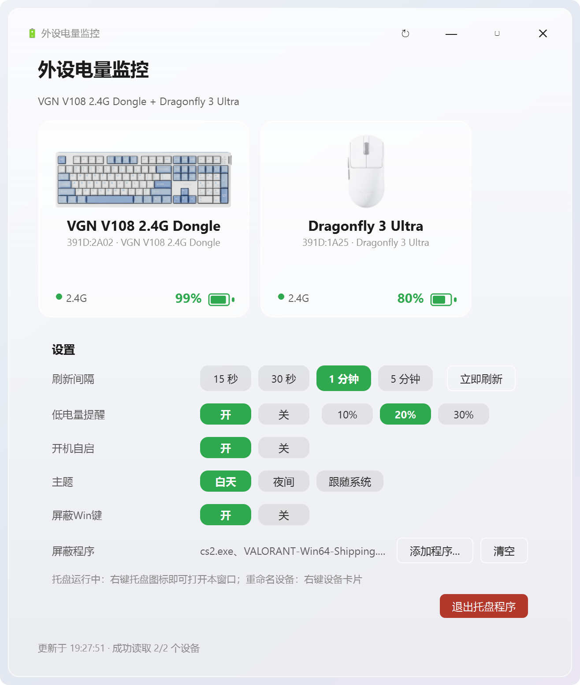
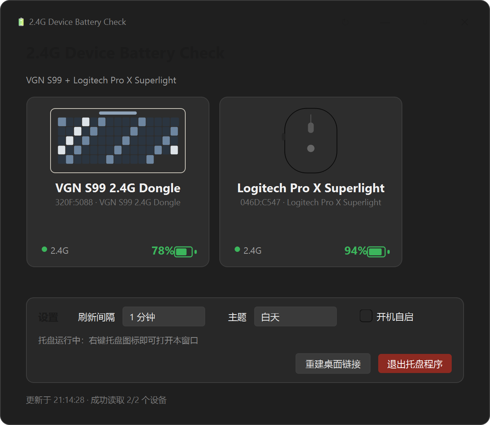
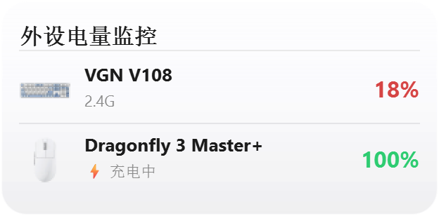
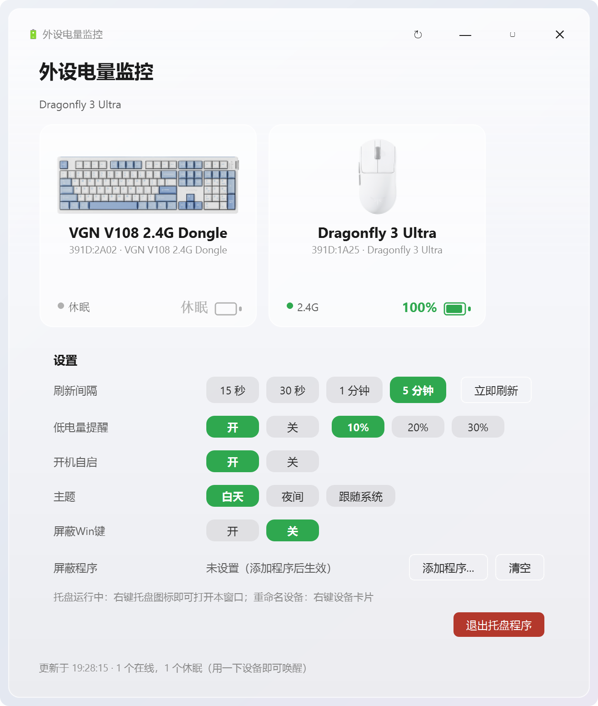

# 2.4G Battery Check — 2.4G 键盘/鼠标电量监控

一个常驻托盘的 Windows 小工具：直接通过 USB 接收器的 HID 私有协议读取 **VGN 键盘/鼠标**（及罗技、Keychron 等）的实时电量，无需安装厂商驱动。

> **直接下载**：[2.4G-Battery-Check-v1.0.2.exe](https://github.com/InkRain/2.4G-Battery-Check/releases/download/v1.0.2/2.4G-Battery-Check-v1.0.2.exe)　·　Windows 10/11 x64 单文件版（约 37 MB），双击即用，不需要装 Python 或驱动
> 版本说明见 [Releases](https://github.com/InkRain/2.4G-Battery-Check/releases)

## 界面预览

| 主界面（浅色） | 主界面（夜间） |
|---|---|
|  |  |

| 托盘电量面板 | 低电量提醒 |
|---|---|
|  |  |

实机运行（VGN V108 键盘 99%；鼠标休眠时卡片显示"休眠"，托盘图标保留上次电量，用一下设备即自动补扫）：



## 功能

- 🔋 **真实电量**：直接查询接收器，不靠猜——支持电量百分比、充电状态、电池电压
- 🖱️ **VGN 设备优先支持**
  - VGN S99 / VXE75 / N75 等键盘（Evision 方案，`320F:5088`）
  - VGN 蜻蜓 F1/F2、VXE R1 等鼠标（Compx/Nordic 方案，`3554:Fxxx`、`391D:1A05` 等）
  - VGN 蜻蜓 3 代（Dragonfly 3 Ultra 等，`391D:1A25`；这一代接收器只有 feature 接口，走 VGN Ry Feature 协议）
- 🧩 **通用兼容**：罗技 HID++（Unifying/Lightspeed/Bolt）、Keychron Ultra-Link、ATK Nordic 54、MCHOSE Realtek 推送、标准 HID 电池用法
- 🪟 **Windows 11 风格界面**：圆角无边框窗口、液态玻璃质感、浅色/深色/跟随系统主题、设备卡片网格
- 📌 **托盘常驻**：左键弹电量面板（右下角通知卡片），右键菜单；每类设备一个环形电量图标；关闭窗口不退后台
- ⏱️ **定时刷新**：15 秒 / 30 秒 / 1 分钟 / 5 分钟，也可随时手动刷新
- 🔔 **低电量提醒**：阈值可设（如 ≤20%），到点弹右下角玻璃通知，充电后自动复位
- 🚀 **开机自启（静默）**：开机时只驻留托盘，不弹窗口、不弹提醒，不打断你
- ⌨️ **指定程序内屏蔽 Win 键**：为游戏单独屏蔽 Win 键（按前台进程判断），其他程序完全不受影响
- ✏️ **设备重命名**：右键卡片可改成你习惯叫的名字
- 🧪 **演示模式**（`--demo`）与 **诊断模式**（`--diag`）
- 🧹 **单实例 + 自清理**：重复启动不会开出第二份托盘；单文件版残留的临时解压目录会自动清扫

## 快速开始

### 方式一：下载现成的 exe（推荐给普通用户）

到 [Releases](https://github.com/InkRain/2.4G-Battery-Check/releases) 下载 `2.4G-Battery-Check-v1.0.2.exe`，
放到任意目录双击即可（建议固定到桌面或开始菜单）。首次运行会自解压到 `%TEMP%`，约 2–3 秒出界面；
若被 SmartScreen 拦截，选择「更多信息 → 仍要运行」。

### 方式二：源码运行（需要 Python 3.10+）

```bash
pip install -r requirements.txt
python main.py            # 启动（托盘 + 主窗口）
python main.py --tray     # 静默启动：只驻留托盘（开机自启用的就是它）
python main.py --demo     # 演示模式（无硬件预览界面）
python main.py --diag     # 诊断：打印所有 HID 设备与协议探测结果
```

### 方式三：自己打包单文件 exe

```bash
pip install pyinstaller
python -m PyInstaller --noconfirm --clean --onefile --windowed \
    --name "2.4G Battery Check" --icon "app/resources/app.ico" \
    --add-data "app/resources;app/resources" main.py
```

产物是单个 `dist/2.4G Battery Check.exe`（约 37 MB，Qt 运行库已内嵌），
拷到任意位置双击即可运行，不需要携带其他文件。Windows 用户也可以直接双击 `build.bat`。

## 使用说明

1. 插入 2.4G 接收器，键盘/鼠标开机并处于 2.4G 模式
2. 启动程序，约 1-2 秒后出现设备卡片与电量
3. **键盘休眠时无法查询**：2.4G 键盘无操作约 30 分钟后会断开链路，此时卡片显示"休眠"——按任意键唤醒后会自动补扫恢复（托盘图标保留上次电量，不会变灰）
4. 关闭窗口只是隐藏到托盘；右键托盘图标 → 退出 才会完全退出
5. 开机自启用 `--tray` 参数启动，只驻留托盘；想让它开机就显示窗口，把注册表里 `HKCU\Software\Microsoft\Windows\CurrentVersion\Run` 的 `2.4GBatteryCheck` 值末尾的 `--tray` 去掉即可

### 屏蔽 Win 键（游戏模式）

设置里开启「屏蔽Win键」，再点「添加程序…」选择要屏蔽的程序（如 `cs2.exe`），
之后只有该程序在前台时 Win 键会被拦截（左/右 Win 都拦），切到别的程序立刻恢复。

> 若目标游戏以管理员身份运行（很多带反作弊的游戏都是），本程序也需要右键「以管理员身份运行」，
> 否则 Windows 的 UIPI 权限隔离会让键盘钩子收不到按键。

## 技术原理

Windows 不为 2.4G 接收器类设备提供电量 API，各厂商驱动（VGN HUB、G HUB 等）都是直接与接收器的 HID 厂商集合通信。本工具用纯 `ctypes` 调用 Windows HID API（`setupapi.dll` / `hid.dll`），实现了以下协议：

| 协议 | 设备 | 帧格式 |
|---|---|---|
| Evision | VGN S99/VXE75/N75（`320F:5088`） | `usagePage FF1C` reportId 4，请求 `04 20 00 1A 06`，回包第 8 字节=电量 |
| Compx/Nordic 52 | VGN 蜻蜓/ATK/VXE/Dareu（`3554/391D/373B/260D/33E4`） | 17 字节 reportId 8 子命令 04，回包 offset 6=电量、offset 7=充电、8-9=电压mV |
| VGN Ry Feature | VGN 蜻蜓 3 代起（`391D:1A25` 等，仅 feature 接口） | 64 字节 feature 报告，`F7`+CRC 取状态块，回包 offset 2=电量；`F6 05` 做链路准备 |
| Nordic 54L15 | ATK Zero 等 | 64 字节命令 `72 07` |
| Logitech HID++ | Unifying/Lightspeed/Bolt | `11 <slot> <feat> <fn<<4\|swid>`，特性 0x1004/0x1000/0x1001 |
| Keychron | Ultra-Link 8K / M5 | feature `B3 06` → input `B4 06`，byte 20=电量 |
| Realtek 推送 | MCHOSE 等 | 被动监听 report `13 1D`，XOR 0xFF 解码 |
| 标准 HID | 暴露 Usage 0x06/0x20 的设备 | feature/input 报告直接提取 |

协议知识来源与致谢：Rainy75Desktop（Evision 逆向）、mouse_tray / GearPower（Compx/Nordic）、HaloBattery / Solaar（Logitech HID++）、csutcliff/keychron-battery-dkms（Keychron）、DeskBox issue #510（推送报告机制）。

## 目录结构

```
2.4G-Battery-Check/
├── main.py                  # 入口（--tray / --demo / --diag / --debug）
├── app/
│   ├── hid/core.py          # Windows HID 底层（枚举/Overlapped 读写/Feature）
│   ├── engine/
│   │   ├── models.py        # 设备模型与型号识别表
│   │   ├── protocols.py     # 各厂商电量协议实现
│   │   └── scanner.py       # 扫描调度（后台线程 + 看门狗 + 休眠补扫）
│   ├── core/                # 设置持久化 / 开机自启 / Win 键钩子 / 单实例 / 临时目录清理
│   └── ui/                  # PySide6 界面（主窗口/托盘/弹窗/主题/Toast）
├── tools/                   # 开发期探测与回归测试脚本
├── docs/                    # 界面截图（tools/make_screenshots.py 生成）
└── requirements.txt
```

## 已知限制

- **VGN V108 键盘（`391D:2A02`）**：已通过背赢（Beiying）协议支持 ✅（从 VGN HUB 逆向：输出报告 id 19，命令 `4A 01 00 00 00`，CRC=(19+负载和)&0xFF，应答 content[4]=电量、content[5] 高 4 位=充电）。键盘休眠时无应答，显示"休眠"并保留上次读数
- **VGN 蜻蜓 3 代鼠标（`391D:1A25` Dragonfly 3 Ultra 等）**：已通过 VGN Ry Feature 协议支持 ✅。这一代接收器只暴露一个 65 字节 feature 集合（`FFFF:0002`）、没有输出报告，所以老的 Nordic 52 协议必然失败。命令帧 64 字节：`F7 00 00 00 00 00 <CRC>`，回包首字节 1 表示接收器已同步、第 3 字节为电量；接收器未同步时先发 `F6 05` 做链路准备。此协议在 2.4G 模式下读的是接收器缓存值，鼠标休眠也能保持读数
- **金运 GX-01 耳机（`4C4A:4155`）**：固件未提供电量上报通道（HID 仅有媒体按键），显示"未开放"
- **充电显示**：充电中在卡片上显示橙色"⚡ 充电中"，电量数字变绿，托盘图标叠加闪电标记；鼠标电量按 VGN HUB 同款电压-电量曲线（21 档放电表）换算，与官方驱动读数一致
- **设备产品图**：键盘图提取自 VGN HUB 安装包（`app.asar` 内置 webp 高清渲染图）；鼠标图取自 VGN 官网 Dragonfly 3 系列产品图
- 仅支持 Windows 10/11
- 蓝牙模式设备的电量不在本工具范围内（走系统蓝牙栈）

## 隐私

完全本地运行：不联网、不上传任何数据。日志仅写入 `%LOCALAPPDATA%\2.4GBatteryCheck\`。
